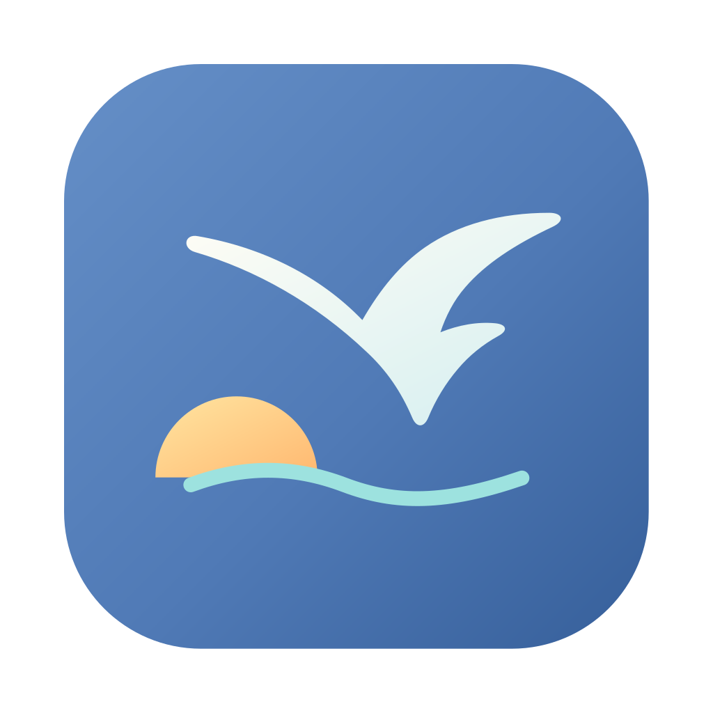

<p align="center">
  
</p>

# Seabird 工作台

Seabird 是一个本地内容工作台，用来收集素材、写文章，并让外部 Agent 使用这些内容。你可以在自己的 Codex 或 Claude Code 中连接 Seabird，继续使用熟悉的 Agent 工作；也可以在 Seabird 内直接对话。

Seabird 不提供模型，需要使用本机已安装并登录的 Agent。桌面应用基于 Tauri 2、React 和 SQLite。


## 连接外部 Agent

1. 安装并打开 Seabird，确认使用的本地素材目录。
2. 打开「设置与文件 → 本地 Agent → 外部 Agent 连接（MCP）」，点击「复制配置任务」。
3. 把任务粘贴给本机的 Codex 或 Claude Code，让它检查并配置自己的连接。
4. 新建一个 Agent 会话，请它调用 `workspace_info`，确认返回的是所选目录。

也可以在同一页面点击「一键连接」，注册本机已安装的 Codex 和 Claude Code。已有的不同 `seabird` MCP 配置不会被覆盖；如有冲突，请先检查旧连接。仅显示注册成功并不代表客户端调用已经验证。

连接绑定当前目录和 Seabird 可执行文件的位置。切换目录或移动应用后，请移除旧连接，再重新配置。

### Agent 能做什么

- **MCP**：获取工作目录，列出文件，读取、创建和覆盖目录中的 UTF-8 文本文件。连接使用本地标准输入输出，不开放网络端口；客户端可以修改所连接目录中的文件。
- **CLI**：读取和保存当前目录的素材与文章，导入图片或视频。素材和文章存储在应用数据库中，当前 MCP 不直接提供这些数据或数据库操作。
- **Skill**：[Seabird Skill](skills/seabird/SKILL.md) 帮助支持 Skills 的 Agent 查找 CLI 并正确读写内容；不安装也可以使用 CLI 和 MCP。

外部 Agent 使用 CLI 时，先运行 Seabird 可执行文件的 `--help`。应用中的「复制配置任务」包含当前安装路径；程序不需要加入 PATH。修改已有素材或文章时，须提供读取到的原始对象作为 `expected`，以检测并发修改；保存后如有备份警告，应检查并处理。

## 使用 Seabird

- **素材**：保存标题、来源、链接、标签和备注，导入图片或视频；可搜索、筛选和删除。删除素材会移除文章中的关联，附件文件会保留。
- **文章**：浏览已保存的文章，编辑正文、关联素材，插入分级标题和本地图片或视频，并复制为 Markdown 或 HTML。复制的本地文件链接只在本机有效，发布时需另行上传文件。删除文章时，已导入的文件会保留。
- **发布日历**：手动记录文章的发布时间，在日历中查看和修改记录。删除文章会同时删除对应的发布记录；删除单条发布记录不会删除文章。
- **应用内 Agent 对话**：使用本机 Codex 或 Claude Code，与 Agent 讨论；可在输入框中选择文章或素材作为引用。在文章详情页对话时，默认关联当前文章；选中正文后可点击「修改选中内容」，输入要求或选择润色、精简等快捷操作，对照建议后替换，再保存文章。应用后也可撤销 Agent 的修改。其他对话中，Agent 可以提供新素材或文章的保存建议。素材默认保留文字和链接，需要时再下载文件。Agent 的提问和操作权限请求可在应用内回复。此功能不需要配置 MCP。
- **热点发现**：输入关注方向，让 Agent 查找相关话题；可将值得保留的内容保存为素材。能否查询实时信息取决于所用 Agent 的能力和配置。
- **文件与数据库**：浏览、编辑工作目录中的文件，或在数据库工具中执行 SQL。文件树默认隐藏 `.git`、`node_modules`、`target` 和符号链接；编辑器不能访问工作目录之外的文件。

首次启动时，Seabird 使用系统文稿目录下的 `seabird` 文件夹（macOS 通常为 `~/Documents/seabird`）作为素材目录，可在「设置与文件」切换。素材和文章按目录区分。图片和视频会复制到目录下的 `seabird-media`；删除素材或移除附件不会删除文件。支持 PNG、JPEG、GIF、WebP、AVIF、MP4、MOV、M4V 和 WebM，单文件最多 1 GB，视频播放取决于系统编解码器。

快捷键：`⌘/Ctrl + S` 保存当前素材、文章或文件；`⌘/Ctrl + 1/2/3` 切换工作台、素材和文章。

## CLI

将下面的 `SEABIRD` 替换为 Seabird 桌面可执行文件的完整路径，路径含空格时保留引号。工作目录必须是已存在的文件夹。

```sh
"SEABIRD" --help
"SEABIRD" status --json
"SEABIRD" workspace get --json
"SEABIRD" workspace set --path "/path/to/workspace" --json
"SEABIRD" agent list --json
"SEABIRD" content list --workspace "/path/to/workspace" --json
"SEABIRD" mcp info --workspace "/path/to/workspace" --json
"SEABIRD" mcp status codex --workspace "/path/to/workspace" --json
"SEABIRD" mcp install codex --workspace "/path/to/workspace" --dry-run --json
"SEABIRD" mcp install codex --workspace "/path/to/workspace" --json
"SEABIRD" mcp remove codex --json
```

将 `codex` 换成 `claude` 可配置 Claude Code。安装只修改指定 Agent，`--dry-run` 可先预览。标准 MCP 客户端可通过 `mcp info` 获取 stdio 的 `command` 和 `args`。`workspace set` 只更新下次启动的默认目录，不会切换已打开的窗口或已注册的 MCP。

内容写入使用 `content save-material` 和 `content save-article`，导入附件使用 `content import-media`；具体参数与 JSON 格式以 `--help` 为准。CLI 失败时返回非零退出状态。

应用内对话通过本机 Agent CLI 执行，支持常见权限审批和用户提问。其他类型的交互请求会显示为不支持；可停止任务并检查 Agent 版本或配置。对话记录按工作目录保存在应用数据库中，继续会话还需要对应 Agent 的原生会话记录。

## 数据与备份

素材和文章的数据库保存在系统应用数据目录，图片和视频保存在素材目录；数据库路径可在「设置与文件 → 数据库工具」中查看。连接配置保存在系统配置目录。数据没有由 Seabird 额外加密。

数据库快照和连接配置备份保存在独立的 `com.seabird.workbench-backups` 应用数据目录，路径显示在「设置与文件」中。保存内容会更新最新快照，并保留每天首次快照；删除素材、文章或执行修改数据库的 SQL 前会额外备份。删除前备份失败时，删除操作会停止。

备份不包含素材目录中的图片和视频，且位于同一台设备，请另行备份。手动恢复数据库时，先关闭 Seabird 并保留现有应用数据目录的副本；将选定快照复制为 `workbench.sqlite3`。原数据库的 `-wal` 和 `-shm` 文件也应先移入保留副本。连接配置可将 `connections-latest.json` 复制为系统配置目录中的 `connections.json`。

## 开发与打包

需要 Node.js、npm、Rust 和 [Tauri 2 系统依赖](https://v2.tauri.app/start/prerequisites/)。

```sh
git clone git@github.com:jyjyxt/seabird-work-desktop.git
cd seabird-work-desktop
npm install
npm run tauri dev
```

仓库需要相应访问权限。只预览界面可运行 `npm run dev`；本地文件、Agent 和数据库功能需要在 Tauri 桌面应用中使用。

```sh
npm run tauri build
```

请在目标系统上分别构建和验证安装包。
