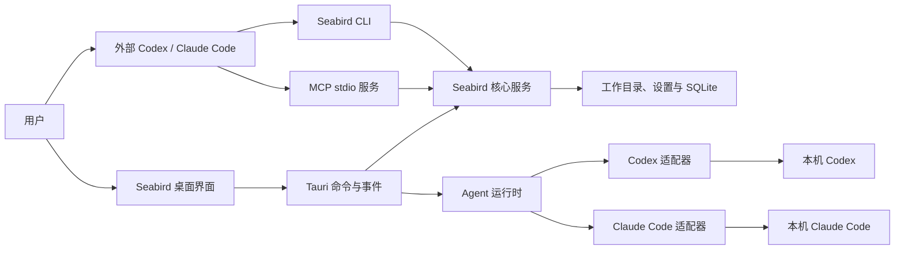

# Seabird Agent 双向接入设计

## 目标与边界

Seabird 是本地工作台。Codex、Claude Code 等 Agent 负责模型调用、工具选择、上下文、会话和自身权限策略；Seabird 提供工作目录、文件和工作台能力，并提供启动 Agent 所需的适配。参考 [OpenDesign 的 Agent 适配器设计](https://github.com/nexu-io/open-design/blob/main/docs/agent-adapters.md)，支持两个独立方向：

1. **外部 Agent → Seabird**：用户在自己的 Agent 中请求操作 Seabird；Agent 通过 Seabird CLI 或 MCP 使用公开能力。
2. **Seabird → 本机 Agent**：用户在 Seabird 中选择已安装的 Agent 并发送任务；Seabird 启动它、转发交互并展示结果。

两个方向可以单独使用。产品内对话不以注册 Seabird MCP 为前提；安装 MCP 也不意味着用户必须在 Seabird 内对话。CLI、MCP 和桌面端共享业务实现，不互相模拟点击。Seabird 不实现自己的模型调用或 Agent 循环，也不要求用户另行填写模型 API Key。

本文是目标设计；其中新命令、接口及文件布局均为拟定，不代表已经实现。

## 总体结构



第一阶段沿用 Tauri + Rust 和现有进程模型，CLI 和 MCP 直接调用核心服务，不增加常驻服务或网络端口。只有出现必须跨进程操作实时 UI、任务管理等需求时，再单独设计本地服务及其身份验证和生命周期。

## 一、外部 Agent 调用 Seabird

### 1. 可发现的 CLI

发布一个与桌面应用版本一致的 `seabird` CLI。桌面应用提供安装/定位命令的入口，并展示当前平台的准确可执行文件路径；CLI 在不打开桌面窗口的情况下可用。打包时应验证 macOS 应用包、Windows 和 Linux 的实际可执行路径及 PATH 行为，不假定应用包里的二进制天然在 PATH 中。

拟定首批命令：

```text
seabird --help
seabird version --json
seabird status --json
seabird workspace get --json
seabird workspace set --path <path> --json
seabird agent list --json
seabird mcp info --workspace <path> --json
seabird mcp install <codex|claude> --workspace <path> [--dry-run] --json
seabird mcp status <codex|claude> --workspace <path> --json
seabird mcp remove <codex|claude> --json
seabird mcp serve --workspace <path>
```

`status` 和 `mcp status` 只读；`install` 只操作指定 Agent，不隐式修改其他 Agent；`--dry-run` 只返回计划，不写配置。重复安装相同配置应无副作用，遇到同名但不同配置时返回冲突和当前/目标配置摘要，不自动覆盖。移除仅针对指定 Agent 的 Seabird 连接。Agent 通过自身的权限规则处理写入或其他授权请求。

`workspace set` 更新持久化的默认目录，供新启动的应用和未显式指定目录的命令使用；不强制切换已打开窗口、运行中的任务或已注册的 MCP。当前阶段没有跨进程 UI 通知，因此该命令不能声称已经切换运行中的窗口；界面下次启动时读取新默认值，窗口内切换仍走已有的交互和未保存内容保护。需要实时同步时再设计通知、冲突和编辑状态处理。

`--json` 输出稳定的机器可读对象，标准输出只放结果，诊断信息放标准错误；失败使用非零退出码。错误应有稳定 `code`、可读 `message` 和可执行的 `next_action`，避免要求 Agent 解析自然语言。建议结果带 `schema_version`，但不把登录状态、注册状态和实际可用性混成一个布尔值。示例：

```json
{
  "schema_version": 1,
  "agent": "codex",
  "workspace": "/path/to/workspace",
  "registration": "configured",
  "server_handshake": "passed",
  "client_tool_call": "not_checked",
  "next_action": "在新的 Codex 会话中调用 workspace_info 验证连接"
}
```

`server_handshake` 只说明 Seabird MCP 进程响应了初始化；读取 Agent 的注册配置只说明配置已写入。只有目标 Agent 新会话实际列出或调用工具后，才能称为客户端端到端验证成功。

### 2. MCP 是能力接口，不是运行时

MCP 使用 stdio 由客户端启动，不开放网络端口。首批保留现有 `workspace_info`、`list_files`、`read_file`、`write_file`，并与 CLI、桌面端调用相同的工作目录和文件服务。工具描述应包含路径约束、大小限制、覆盖语义及错误信息。是否增加数据库或其他能力，按实际用户任务逐项定义，不能暗示现有 MCP 已支持它们。

注册配置采用 `{command, args, env}` 启动描述。Codex、Claude Code 优先使用各自的 `mcp add/get/remove` 命令；尚未核实的客户端仅输出配置片段，不猜测路径并写入。`mcp info` 返回可供其他 MCP 客户端使用的结构化启动描述。

工作目录由 `mcp serve --workspace <path>` 显式绑定，工具只能访问该目录内通过路径校验的资源。切换 Seabird 界面目录不会悄悄改变已注册连接；状态应展示连接目标及与当前目录是否一致。旧连接存在冲突时，给出可检查的迁移指引，不自动删除。

### 3. Agent 可读说明

提供一个简短的 `seabird` Skill 或同等可发现说明：说明何时使用、如何找到 CLI、先读 `--help`、如何检查状态并验证结果。具体命令参数的真源是当前安装版本的 CLI 帮助；Skill 不应复制长篇可过期的命令表。应用可提供“复制给 Agent”的任务文本，包含当前 CLI 路径、目标和验证要求；普通用户也可以直接使用界面。

示例任务：

> 请检查这台电脑上的 Seabird 和你自己的连接状态；使用 Seabird CLI 的帮助完成当前工作目录的 MCP 接入，保留其他配置，报告结果。若存在同名冲突或需要登录，请先说明情况。

不把 Skill 安装作为基础使用的硬前提，也不假设所有 Agent 都支持 Skill。命令路径必须来自安装实例，不能将机器上的示例路径硬编码进发布文档。

## 二、Seabird 内启动本机 Agent

### 1. 运行时适配器

借鉴 OpenDesign 的“Agent 定义 + 共享引擎”，把每个 Agent 的差异限定在适配层。第一批只支持现有 Codex 和 Claude Code，不因为架构预留而宣称其他 Agent 已支持。

每个适配器定义：

- 身份、可执行文件候选、版本及登录状态探测方式。
- 启动参数、工作目录、环境变量和请求输入方式。
- 传输协议与消息解析器；将原生消息转换为统一事件。
- 会话创建、恢复、停止和用户问题/权限请求的能力及限制。

运行时负责解析命令路径、创建子进程、管理生命周期、传递事件和停止进程。Codex 继续使用其 App Server，Claude Code 继续使用其流式控制接口；它们不是同一协议，无法只靠配置数据消除解析器和交互差异。新增 Agent 时可以复用已有传输解析器；确有新协议时添加解析器，而不是把差异塞进共享引擎。

安装、登录和连接分开展示：`未安装 / 已安装`、`已登录 / 未登录 / 未知`、MCP 的独立状态。不能通过版本检测推断登录成功；不能通过注册 MCP 推断模型认证成功。检测失败应隔离到对应 Agent，允许重新扫描，并展示可操作的错误。

### 2. 统一事件和会话

产品内部采用带 `run_id`、`agent_id`、可选 `session_id` 的结构化事件：文本增量、工具活动、会话建立、用户提问、权限请求、完成、失败、取消。原生协议中不支持或无法识别的请求必须明确显示，并允许停止；不能伪造成功或自动批准。

会话分两层：Seabird 保存展示所需的对话元数据及 Agent 原生会话 ID；上下文恢复仍由对应 Agent 负责。原生会话不存在或恢复失败时，明确报告，不静默切换 Agent、不声称已恢复上下文。取消需要尽可能结束整个进程树，并保证界面最终离开运行状态；各平台行为分别测试。

在同一窗口中切换 Agent，只影响新会话；已有会话继续绑定原 Agent。是否未来支持在不同 Agent 之间显式移交上下文，另行设计，不默认自动迁移。

### 3. 与产品能力的关系

Agent 原生文件和命令工具可能已能访问工作目录；是否需要将 Seabird MCP 注入产品内会话，应由具体功能决定，不能把它作为运行 Agent 的先决条件。工作目录是任务的默认位置，不自动等同于 Agent 的安全沙箱：实际文件、命令和网络权限由其运行配置及用户授权决定。

## 共享核心与代码组织

建议按职责逐步调整，文件名可随实现细化：

```text
src-tauri/src/
  core/                 # workspace、文件、设置、数据库等领域服务
  cli/                  # 参数解析、JSON 输出和退出码
  mcp/                  # stdio 协议及工具到核心服务的映射
  agents/
    registry.rs         # 已支持的适配器注册
    detection.rs        # 可执行文件、版本和认证探测
    runtime.rs          # 进程、事件、会话生命周期
    codex.rs            # App Server 协议
    claude.rs           # Claude 流式控制协议
  commands/             # Tauri 调用核心服务和运行时
```

当前 [interactive.rs](../src-tauri/src/interactive.rs) 是实际交互路径，[agent_adapter.rs](../src-tauri/src/agent_adapter.rs) 对应另一条 CLI JSONL 路径；迁移前先确认调用关系，保留仍被使用的行为和测试，再消除重复。现有 [setup.rs](../src-tauri/src/setup.rs) 的 MCP 握手、冲突保护和检测逻辑应迁到共享服务，由 CLI 和桌面端复用。

桌面端当前设置和 SQLite 路径依赖现有应用数据目录：抽离时必须让 CLI 与桌面端解析到**同一位置**，并验证已有数据可读。多进程同时写设置需要原子写入和并发协调，数据库继续使用 SQLite 自身事务；不得在引入 CLI 后形成两份互相覆盖的状态。

## 迁移顺序与验收

1. **梳理和抽离共享服务**：保持现有界面、数据位置、工作目录语义不变；文件操作、MCP 和 Tauri 调用同一实现。验收桌面端现有功能及旧数据。
2. **完善 CLI 与 MCP**：实现帮助、状态、单 Agent 注册/预览/移除和结构化输出；保留 `--setup`、`--mcp` 旧入口作为兼容别名，说明迁移方式，不突然破坏已注册的连接。验收重复执行、冲突、缺失 Agent、不同目录及含空格路径。
3. **整理运行时适配**：将检测、进程管理及事件转换从平台协议中分离；对照真实版本测试 Codex 与 Claude 的流式输出、提问、审批、恢复、错误和取消。保持权限策略，不能为了统一接口自动放宽权限。
4. **补齐发现与说明**：提供短 Skill / 接入文档及“复制给 Agent”的入口；界面分别展示“在 Seabird 中使用 Agent”和“让外部 Agent 使用 Seabird”。验收从全新机器按说明完成配置及新会话内的真实工具调用。

每阶段先在 macOS 验证当前目标环境；Windows 和 Linux 必须在相应系统验证打包、路径、进程终止和 CLI 调用后再宣称支持。最终验收同时覆盖两条独立路径：外部 Agent 调用 Seabird 工具；Seabird 内选择 Agent 并完成带权限交互的真实任务。以真实 Agent 新会话结果为准，不能只用模拟器或 MCP 初始化代替端到端验证。
